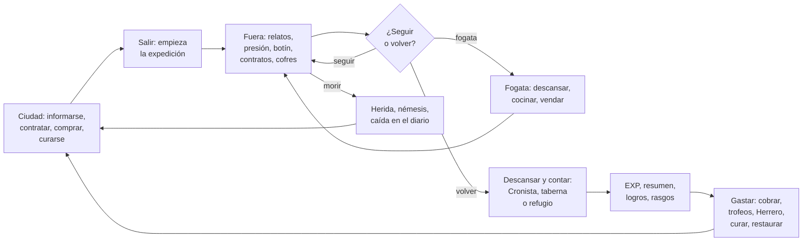

# Flujo del juego

Cómo se juega una partida con todos los mods de `my-mods/` activos: qué hace
el jugador, en qué orden, qué mod interviene en cada momento y cómo se
conectan entre ellos. Sirve para revisar el diseño de conjunto y como punto de
partida de los diseños futuros: antes de añadir un sistema, mira en qué paso
del bucle entra y qué paso refuerza.

Escrito el 2026-10-24 con lo que hay en el código ese día. **Muchas piezas
están escritas y sin probar en el juego**: el estado real de cada mod está en
la sección «Estado» de su README, y este documento no lo repite. Lo
decidido está en [`DECISIONS.md`](./DECISIONS.md) (se citan los números) y lo
pendiente, en [`ROADMAP.md`](./ROADMAP.md). Los valores (minutos, porcentajes,
precios) son **de prueba** salvo que se diga otra cosa; casi todos se cambian
en Settings → Mods.

## El bucle en una frase

**Te preparas en la ciudad, sales, vives cosas por primera vez bajo una
presión que crece con el Tier, vuelves con botín y relatos, y al descansar los
cuentas: eso te sube de nivel y te deja más preparado para ir más lejos.**

Tres ideas sostienen el bucle (más en el [README](./README.md#dirección-de-diseño)):

- **Avanzar paga más que repetir** (D9): la EXP sale de los *relatos*, lo vivido
  por primera vez; los monstruos siguen a 1x (D8).
- **Salir exige prepararse** (D18): hambre, sed, temperatura, clima y heridas
  presionan más cuanto más alto es el Tier, y cada castigo tiene un premio
  espejo para quien va preparado ([`BALANCE.md`](./BALANCE.md)).
- **Volver tiene sentido** (D10, D11): la expedición solo se cierra al
  descansar y contar, y lo que se trae se gasta en la ciudad.

## 1. En la ciudad: prepararse

En las ciudades y los interiores del atlas no hay presión: hambre y sed no
bajan (D16), no hay temperatura ni heridas al morir. Es donde se decide
adónde ir y con qué.

**Mientras duren las pruebas, casi todo está junto al tablero de Prontera**
(D23), para que las sesiones sean cortas. En la partida final se reparte por
interiores y ciudades: es parte de «hacer funcionales las ciudades».

| Necesidad | Dónde (Prontera, en pruebas) | Mod |
|---|---|---|
| Saber qué tiempo hará | **Pronosticador** (`168,193`): el evento de cada mapa, lo que queda y el siguiente, ya sorteado, con su protección. Gratis | `clima` |
| Saber más, por una ronda | **Tabernero** (`prt_in 180,23`): el tiempo donde está tu contrato o tu némesis, dónde anda tu marca y qué elemento le duele, dónde te espera tu némesis | `tavern-rumors` |
| Un motivo para salir, por unas rondas | **Tabernero**: el rumor de un alijo escondido en un campo de otra región, un Tier por encima, con botín de cofre (D41, D45) | `tavern-rumors` 0.4 |
| Un objetivo | **Tablero** (`160,193`): marcas y cacerías de la ciudad. **Intendente** (`162,193`): cobra las marcas y da las **marcas de élite** a cambio de un trofeo | `expedition-board` |
| Ropa para el frío o el calor | **Sastre del Viajero** (`149,187`): Capa de Piel, Chaleco de Lana, Manto de Lino, Túnica Fresca | `temperature` |
| Agua para el camino | **Vendedor de Cantimploras** (`147,187`) | `survival` |
| Fuego para el camino | **Proveedor de Campamento** (`151,187`): leña, kit de acampada, vendas | `campfire` |
| Curar heridas | **Posadero** (`164,193`, todas las heridas por zeny) y **Sacerdote** (`166,193`, una herida o maldición por donación) | `wounds` |
| Trabajar el botín | **Herrero de Afijos** (`155,187`): pasar, quitar, volver a sortear afijos y engarzar trofeos | `dungeon-chest` |
| Colgar trofeos | **Coleccionista** (`157,187` en pruebas; el de verdad en **Payon** `180,104`) | `expedition-board` |
| Ir a un refugio restaurado | **Caravana de los Refugios** (`153,187`) | `refuges` |
| Contar los relatos | **Cronista** (`158,193`, en las 7 ciudades) o la taberna | `adventure` |

Las protecciones contra el clima (Manto de Lluvia, Armadura Horno…) no se
venden hoy: salen de los cofres (D38). La comida y las bebidas, de las
tiendas de siempre y de la fogata.

**La decisión de la ciudad:** adónde ir (Tier y bioma), qué clima habrá allí,
qué ropa y qué protección llevar, cuánta comida y agua, si curar las heridas
antes de salir y qué contrato aceptar.

## 2. Salir: empieza la expedición

Al pisar el primer mapa del atlas que no es ciudad, `adventure` dice
«Empieza la expedición N» y empieza a contar el tiempo fuera. Pasar por una
ciudad sin descansar **no** la cierra (D11): la expedición sigue, y su racha
también.

Desde ese momento corren, cada uno con su propio reloj de NPC (D22):

| Sistema | Qué pasa fuera | Mod |
|---|---|---|
| Hambre y sed | bajan 1 punto cada 15 s (de prueba); el clima puede doblar una | `survival` |
| Temperatura | cada 4 s, sensación = temperatura del mapa + clima + ropa, de Congelado (−3) a Sofocado (+3) | `temperature` |
| Clima | eventos de 5 minutos por mapa, según su bioma, con un estado alterado o más gasto de hambre o sed | `clima` |
| Heridas | lo que traes de antes sigue restando | `wounds` |

## 3. Fuera: qué se vive

### Relatos: lo que da la EXP

Cada cosa vivida por primera vez queda como **relato sin contar**; al ganarlo
solo se anuncia su nombre (D27) y se ve en la pestaña Relatos del diario
(Alt+J). Su EXP se calcula al ganarlo, como porcentaje del nivel, con el
**factor de Tier** (lo que está por debajo de tu banda deja de pagar, lo que
está por encima paga hasta el doble) y la **racha** (+10 % por cada relato ya
ganado en esta expedición, hasta +50 %). Ningún relato paga más del 60 % de un
nivel. Detalle en [`ADVENTURE.md`](./ADVENTURE.md#cuánta-exp-da-una-experiencia).

| Relato | Tamaño | De dónde sale |
|---|---|---|
| Primera vez en un mapa | Menor | `adventure` |
| Primera vez en un bioma | Media | `adventure` |
| Primer paso en un Tier | **Hito** | `adventure` |
| Más de 30, 60 y 120 minutos fuera | Media | `adventure` |
| Volver «por los pelos» (menos del 20 % de HP, o hambre o sed en 0) | Media | `adventure` |
| El primer MVP de cada especie | Mayor | `adventure` |
| El primer cofre de un mapa / de un Tier | Menor / Mayor | `dungeon-chest` |
| Abatir una marca / una marca de élite | Media / Mayor | `expedition-board` |
| Completar una cacería | Menor | `expedition-board` |
| Tu equipo te protegió de un clima / aguantar uno sin protección | Media / Menor | `clima` |
| Cómodo en pleno frío o calor gracias a la ropa | Media | `temperature` |
| La primera vez con cada herida | Media | `wounds` |
| Vencer a tu némesis (de rango 3: Hito) | Mayor | `nemesis` |
| Encender la primera fogata, cocinar por primera vez | Menor | `campfire` |
| Restaurar un refugio (etapa 1) | Mayor | `refuges` |

Los de cofre, marca, MVP y refugio se comparten con el compañero de grupo que
esté en el mismo mapa (la regla de grupo de [`CONVENTIONS.md`](./CONVENTIONS.md)).

### La presión y su recompensa

Cada sistema castiga un **eje distinto**, avisa antes de castigar y tiene un
estado positivo para quien va preparado. Si la presión de todos a la vez
pasa de 6 (`@pr_*`), los castigos se reducen en proporción: nunca se acumulan
hasta impedir jugar ([`BALANCE.md`](./BALANCE.md#tope-de-presión)). `@presion`
lo enseña.

| Sistema | Castiga | Premia | Cómo se prepara uno |
|---|---|---|---|
| Hambre (`survival`) | sin regeneración de HP; en 0, HP máx y ATK −10 % | **Bien alimentado** (más de 70): regeneración de HP +20 % | comida; platos de la fogata |
| Sed (`survival`) | sin regeneración de SP; en 0, lanzamiento y ASPD más lentos | **Hidratado**: regeneración de SP +20 % | bebidas, pociones; la cantimplora se rellena en el agua |
| Las dos en 0 | además, movimiento −20 % | — | — |
| Frío y calor (`temperature`) | Helado/Acalorado: AGI o INT; Congelado/Sofocado: dos atributos y HP o SP máx | **Bien abrigado**: HP y SP máx +3 % si la ropa compensa un lugar extremo | ropa del Sastre o de los cofres; una fogata da Cómodo |
| Clima (`clima`) | un estado alterado (veneno, congelación, ceguera…) o el doble de hambre o sed | su relato al protegerte | la protección de esa combinación; el pronóstico dice cuál |
| Heridas (`wounds`) | un atributo o HP/SP máx, hasta curarlas | — (la cura es en la ciudad) | Descansado evita la primera; la venda deja una a la mitad |

### Lugares y actividades

- **Campos.** Relatos de mapa y bioma, clima, contratos, monstruos para la
  cocina y los refugios. El agua de un campo llena la cantimplora (solo la
  que se pisa).
- **Mazmorras.** Un **cofre** por mapa (`dungeon-chest`) en una celda al
  azar. Al abrirlo: un disfraz (5 %), un objeto de `clima` o `temperature`
  para ese bioma (10 %, D38), una pieza de equipo **sin identificar** con 1
  a 4 afijos del Tier y con tendencia a tu clase (80 %, D35) o la comida del
  Tier. El botín se descubre con una Lupa: se lleva de vuelta.
- **Contratos** (`expedition-board`). Una **marca** es un monstruo con nombre
  en un punto de un mapa, reforzado por el Tier; una **cacería** pide abatir
  N de una especie en un mapa. Las dos se cobran en la ciudad que las
  publicó. Toda marca abatida da un **trofeo de su raza** (D40).
- **Marcas de élite.** El Intendente las da a cambio de un trofeo de la raza:
  una por ciudad, un Tier más arriba, más duras, con dos trofeos de premio.
- **Fogata** (`campfire`). Con leña o un kit aparece una fogata en tu celda,
  que cualquiera puede usar (D28). Junto a ella la temperatura es Cómodo.
  Se habla con ella para **descansar** (Descansado 20 minutos: más
  regeneración y la primera muerte no deja herida), **cocinar** drops de
  monstruos en platos con buff que sacian (D30) o **vendar** una herida a la
  mitad (D29). **No sirve para contar relatos** (D10).
- **Refugios** (`refuges`). Ruinas en los campos que se restauran entre todos
  y para el mundo entero (D32), en tres etapas de drops de la región y zeny
  (D33): 1, una fogata bajo techo donde **sí se cuentan los relatos**; 2, un
  intendente con provisiones; 3, una caravana a la ciudad (D34). Hoy: la
  Abadía (`prt_monk`, Tier 1) y el Paso Goblin (`prt_fild11`, Tier 2).

**La decisión de fuera:** seguir o volver. Seguir sube la racha y abre
relatos de Tiers más altos, pero la presión aumenta y una muerte cuesta una
herida y crea un némesis. Volver cierra la expedición al contarla.

## 4. Morir

Morir fuera de una ciudad no quita lo ganado: los relatos sin contar siguen
ahí. Pero deja marca:

1. **Una herida** (`wounds`), si no te protegía Descansado: con nombre, según
   quién te mató (su raza), el bioma, el clima activo o tu propia marca. Hasta
   tres a la vez. Resta hasta curarla en la posada (heridas) o el templo
   (también maldiciones). Nunca impide jugar (D15).
2. **Un némesis** (`nemesis`), si no tenías ya uno: el monstruo que te mató te
   espera con nombre donde caíste y sube de rango si vuelve a matarte (D17).
   No lo son los MVP ni las marcas de contrato.
3. **Una caída** en el diario y en el resumen de la expedición.

Vencer al némesis cura las heridas que te dejó, da su relato y un
**talismán** firmado con afijos de su historia: daño contra su raza por su
rango y el atributo que te quitaba su herida (D40).

Qué cuesta morir en `adventure` sigue abierto
([`DECISIONS.md`](./DECISIONS.md#abiertas)).

## 5. Volver

Al pisar la ciudad, `adventure` suma el tiempo fuera y puede dar los relatos
de expedición larga y «por los pelos» (este, no si vuelves reapareciendo tras
morir). Hambre y sed dejan de bajar; la temperatura y el clima no te siguen.
La expedición **sigue abierta** hasta descansar.

Volver tiene tres caminos: a pie, con el warp de la Kafra (gratis durante las
pruebas; de pago en la partida final, D24) o con la caravana de un refugio
restaurado.

## 6. Descansar y contar

Se cuenta con el **Cronista** (en las 7 ciudades), en la **taberna** de
Prontera o en la **fogata de un refugio restaurado**. Contar es gratis (D26).
Al contar:

- cada relato paga su EXP base y de oficio;
- se escribe el **resumen de la expedición** en el diario («Expedición 3 ·
  1 h 12 min fuera · Campo de Prontera 08 → Laberinto 3 · 9 relatos (+86 % de
  nivel) · 1 caída»), visible en la pestaña Expediciones;
- se completan los **logros** de los relatos Mayores e Hitos, con un disfraz
  por correo (D39);
- se cierra la expedición y la racha vuelve a 0.

En el refugio, además, Descansado de `campfire`.

## 7. Gastar lo ganado

| Qué traes | Qué haces con ello | Dónde |
|---|---|---|
| Un contrato cumplido | cobrar zeny y su recompensa | Intendente o tablero |
| Un **trofeo de marca** o un **talismán** | llevarlo puesto (+10 % de daño contra su raza), entregarlo como prueba de una marca de élite (solo el de marca), engarzarlo en una pieza (+5 % / +8 %) o colgarlo por defensa permanente contra su raza (+1 % / +2 %, hasta 10 % por raza). Una sola cosa: los tres últimos lo gastan (D40) | puesto, Intendente, Herrero, Coleccionista (Payon) |
| Equipo sin identificar | identificarlo (Lupa) y trabajar sus afijos | Herrero de Afijos (D37) |
| Drops de monstruos | cocinar, restaurar un refugio, vender | fogata, refugio, tiendas |
| Heridas | curarlas | Posadero, Sacerdote |
| Zeny | todo lo anterior: curar, rondas de la taberna, el Herrero, los refugios, la caravana | — |

El zeny no sale de los monstruos en la partida final (D24): sale de los
contratos y de vender el botín, y se va en curarse, prepararse y mejorar.

## Progresión: qué te hace más fuerte

| Qué | Cómo se gana | Qué da | Mod |
|---|---|---|---|
| Nivel | contar relatos (y los monstruos a 1x) | lo de siempre | `adventure` |
| **Rasgos** | vivir la presión: 30 min en la nieve, 30 en desierto o volcán, relatos de 5 biomas, curar 3 heridas distintas | el frío o el calor cuentan un grado menos; hambre y sed un 20 % más lentas; las heridas restan un punto menos | `adventure`, leídos por `temperature`, `survival` y `wounds` |
| **Logros** | contar relatos Mayores e Hitos | un disfraz por correo y puntos de logro | `adventure` |
| Equipo con afijos | cofres; el Herrero | lo que digan sus afijos | `dungeon-chest` |
| **Trofeos y talismanes** | marcas y némesis | daño puesto, afijos engarzados, defensa permanente colgada | `expedition-board`, `nemesis`, `dungeon-chest` |
| Refugios | restaurarlos | descanso, provisiones y atajos en el mundo | `refuges` |
| Diario | todo | la historia del personaje, que se lee | `adventure` |

## Cómo se conectan los mods

Ninguno exige a otro salvo `adventure` y `temperature`, que piden
`world-atlas`; el resto son **dependencias suaves**: sin el otro mod, esa parte
no hace nada y el mod sigue funcionando. Lo que un mod lee de otro va en
variables de personaje con el prefijo del que las escribe (`@clima_*`,
`@pr_*`, `adv_trait_*`) o en funciones públicas (`F_<Mod>_*`); el mod store es
de cada mod.

| Mod | Da a los demás | Lee de los demás |
|---|---|---|
| `world-atlas` | por mapa: tipo, bioma, Tier, temperatura, ciudad ancla, agua (`F_Atlas_*`) | — |
| `adventure` | relatos (`F_Adv_Experience`), notas del diario (`F_Adv_Note`), contar (`Adventure::OnRest`), rasgos (`adv_trait_*`), curas (`F_Adv_Cured`) | atlas; hambre y sed de `survival` |
| `survival` | hambre, sed, presión (`@pr_survival`) | clima (gasto extra), atlas (ciudades), rasgo Buscavidas |
| `clima` | eventos y pronóstico (`F_Clima_*`), exposición (`@clima_*`) | atlas (bioma) |
| `temperature` | estado, presión (`@pr_temp`) | atlas, clima, ropa, fogatas de `campfire`, rasgos |
| `wounds` | heridas, curas (`F_Wounds_*`), presión (`@pr_wounds`) | atlas, clima, marca del contrato, Descansado, rasgo Curtido |
| `expedition-board` | contratos, trofeos de marca, Coleccionista | atlas (Tier), talismanes de `nemesis` |
| `dungeon-chest` | cofres y botín, Herrero | atlas (Tier y bioma), objetos de `clima` y `temperature`, trofeos |
| `nemesis` | némesis y talismanes (`F_Nemesis_*`) | atlas, heridas de `wounds` (cura y afijo) |
| `tavern-rumors` | rumores; el alijo de un rumor; un lugar donde contar | clima, contrato, némesis, atlas, botín de `dungeon-chest` |
| `campfire` | fogatas, Descansado (`F_Campfire_*`), platos | atlas, `survival` (saciar), `wounds` (venda) |
| `refuges` | refugios, caravana; un lugar donde contar | `campfire` (Descansado), atlas, `adventure` |

`affix-forge` y `arpg-equipments` son referencia (MIT) y no se activan: sus
datos ya están en `dungeon-chest`.

## Ejemplo: la primera tarde de un personaje

Un Swordman nuevo, nivel 10, en Prontera.

1. **Ciudad.** El tablero ofrece cazar 15 Fabre en el campo sur. El
   Pronosticador dice que en `prt_fild08` empieza una Lluvia tóxica dentro de
   4 minutos y que protege el Manto de Lluvia, que no tiene. Compra una
   cantimplora y leña.
2. **Salir.** En `prt_fild08`: «Empieza la expedición 1» y tres relatos (el
   mapa, la pradera, el Tier 1); la pestaña Relatos dice «racha +30 %».
3. **Fuera.** Caza los Fabre bajo la lluvia, envenenado a ratos; al acabar el
   evento gana «Aguanté el clima sin protección». Completa la cacería. Con la
   sed bajando, bebe de la cantimplora: en este campo no hay agua para
   rellenarla.
4. **Más lejos.** Sigue a la Abadía (`prt_monk`): ve el Refugio en ruinas y se
   apunta qué pide la primera etapa. Enciende una fogata, cocina dos Carne
   Asada con lo que soltaron los monstruos y descansa: Descansado.
5. **Morir.** En el Laberinto le mata un Wolf. Descansado evita la herida,
   pero el Wolf es ahora «Wolf el Verdugo» y le espera allí.
6. **Volver.** Reaparece en Prontera. Cobra la cacería en el tablero. El
   Tabernero, por una ronda, le dice dónde le espera su némesis y que le
   duele el fuego.
7. **Contar.** Con el Cronista: siete relatos, más de medio nivel, el resumen
   de la expedición en el diario y el logro «Primer paso en Tier 1», con un
   sombrero de aventurero por correo.
8. **Siguiente.** Vuelve al Laberinto preparado, vence al Wolf y recibe un
   Colmillo del Némesis con su nombre: +12 % contra bestias. ¿Lo lleva puesto,
   o lo cuelga en Payon para no volver a temer a los lobos?

## Para diseñar lo siguiente

Al proponer un sistema nuevo, conviene contestar:

1. **¿En qué paso del bucle entra** (ciudad, salir, fuera, morir, volver,
   contar, gastar) y qué decisión añade allí? Si solo pide vigilar una barra,
   sobra.
2. **¿Qué relato publica?** Lo que merezca contarse va a `adventure` con
   `F_Adv_Experience`, con su tamaño y su Tier.
3. **¿Castiga?** Entonces, ¿en qué eje (que no repita otro), con qué aviso,
   con qué estado positivo, y cuenta en el tope `@pr_*`?
4. **¿Da algo que llevar de vuelta?** Lo que se gasta en la ciudad le da
   razones a la ciudad.
5. **¿En qué ciudad o lugar vive?** Repartir servicios da razones para viajar
   (el Coleccionista en Payon es el primer caso).
6. **¿Funciona de a dos?** La regla de grupo de `CONVENTIONS.md`.

Huecos que se ven al recorrer el bucle (el orden y el estado, en
[`ROADMAP.md`](./ROADMAP.md)):

- **Ciudad:** todo vive junto al tablero de Prontera (D23). Falta la
  identidad de cada ciudad: posada, taberna y templo en interiores; la
  taberna solo existe en Prontera; el Coleccionista solo en Payon.
- **Informarse:** no hay bestiario ni pistas del contrato más allá del
  Tabernero. La cadena «Rumor → Pista → Hallazgo» tiene dos formas: el
  alijo de `tavern-rumors`, que lleva a tierras lejanas (D41, D45), y las
  cadenas que nacen de un relato contado o de un talismán y llevan a una
  mazmorra (D42–D44, dos escritas en la 0.4.0; [`RUMORES.md`](./RUMORES.md)).
- **Fuera:** sin **restos ni lore** (`remnants` espera a `LORE.md`), sin
  encuentros en el camino, sin oficios (pesca y minería primero), sin
  pasadizos ni trampas. El clima cambia el estado pero no el cielo (visual
  fijo por mapa, [`ARCHITECTURE.md`](./ARCHITECTURE.md#clima-eventual)); no
  hay día y noche.
- **Morir:** qué cuesta en `adventure` sigue abierto.
- **Contar:** los **saberes** (skills que se aprenden viviendo) esperan a
  decidir qué skills.
- **Gastar:** la economía está abierta: fuentes y sumideros de zeny, precios
  por nivel. Las Esencias de `arpg-equipments` y los disfraces como premio de
  otras actividades están por decidir.
- **Volver:** con el warp de la Kafra de pago, el viaje pesará más; las
  caravanas de los refugios y `waypoint-system` son los atajos que se ganan.
- **Interfaz:** un widget por mod; falta el panel del viajero (necesidades,
  temperatura, heridas, presión, relatos) y los iconos propios
  ([`NOVEDADES.md`](./NOVEDADES.md)).
- **Mundo:** todo lo de arriba está en Prontera e Izlude, Tier 1–2 (D19). Cada
  región nueva repite la lista de H3.
